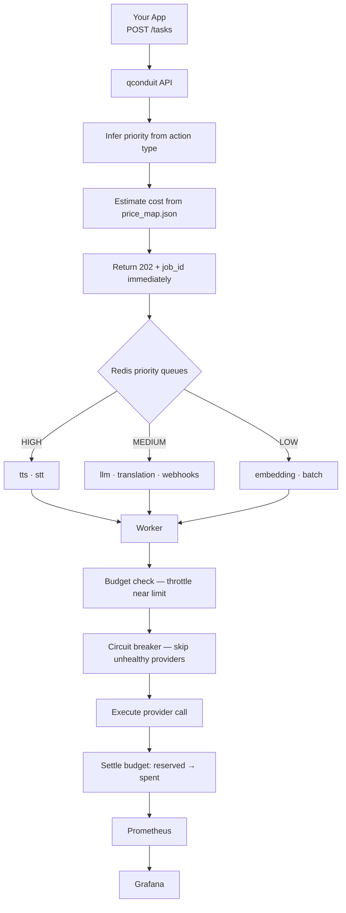

# qconduit — Smart AI Task Scheduler

A lightweight, provider-agnostic async scheduler for AI API workloads.
Sits between your app and any AI API — queues requests, enforces budget limits,
isolates falky providers behind circuit breakers, and gives you a live Grafana view
of every job from submission to completion.

 
[](LICENSE)
[](https://www.python.org/)
[](https://fastapi.tiangolo.com/)
 
**[Live demo →](https://qconduit-production.up.railway.app/)**
 
---

---

## Why qconduit?

AI APIs are slow, expensive, and unpredictable. Calling them synchronously from
a web handler will eventually time out, drain your wallet, or both. qconduit fixes this:

- **Async by default** — your app gets a `job_id` instantly, never blocks on AI execution
- **Priority-aware** — real-time voice (TTS/STT) jumps the queue ahead of batch jobs
- **Budget throttling** — spend limits enforced at the scheduler level, not per-call
- **Circuit breaker** — unhealthy providers get isolated automatically before failures cascade
- **Provider-agnostic** — swap Sarvam ↔ OpenAI ↔ Anthropic by changing one config line
- **Observable** — Prometheus + Grafana wired up out of the box, zero dashboard setup

---

## Where this sits
 
qconduit overlaps with the LLM gateway category — [LiteLLM](https://github.com/BerriAI/litellm), [Portkey](https://github.com/Portkey-AI/gateway), Bifrost and others. Those are mature, well-resourced projects, and if you need a production gateway today you should use one of them.
 
qconduit takes a narrower angle: it is a **scheduler** rather than a proxy. Requests are queued and executed asynchronously across priority lanes instead of being forwarded inline, which is the right shape when latency requirements differ sharply across job types — interactive TTS against overnight batch translation, for example — and when a hard budget ceiling matters more than per-request throughput.
 
It was built to explore that design. It is a working prototype with tests and metrics, not a production gateway.
 
---

## Quickstart

```bash
# 1. Clone and configure
git clone https://github.com/ParanoidParrot/qconduit
cd qconduit
cp .env.example .env
# Edit .env — add API keys, set TOTAL_BUDGET_USD

# 2. Start the full stack (API + Redis + Prometheus + Grafana)
docker compose up

# 3. Fire a burst of demo jobs across all priority lanes
python scripts/demo.py

# 4. Watch live in Grafana
open http://localhost:3000   # admin / admin
```

## Demo

Start the stack, then fire 18 jobs across all priority lanes:
```bash
docker compose up
python3 scripts/demo.py
```
Watch the queue drain live at http://localhost:3000


---

## URLs

Once docker compose up is running:

| URL | What it is |
|-----|------------|
| http://localhost:8000 | Redirects to Swagger UI — try the API interactively |
| http://localhost:8000/docs | Swagger UI — full interactive API documentation |
| http://localhost:8000/health | Health check — confirms API and Redis are connected |
| http://localhost:8000/queue/status | Live queue depths and budget state | 
| http://localhost:8000/metrics | Raw Prometheus metrics scrape endpoint |
| http://localhost:3000 | Grafana — live dashboard (queue drain, budget burn, circuit breakers) |
| https://localhost:3000/d/qconduit | 11 dashboards configured in Grafana |
| http://localhost:9090 | Prometheus — raw metric queries and graph explorer |


API_BASE_URL in .env is not a browsable page — it is used internally to build tracker_url in job responses so callers know where to poll for results.

---

## Architecture Flow

qconduit accepts tasks through a FastAPI endpoint, assigns priority based on the action type, queues work in Redis, executes provider calls through workers, applies budget and circuit-breaker controls, and exposes metrics through Prometheus and Grafana.





---

## Priority lanes

| Priority | Actions | Response shape |
|----------|---------|----------------|
| HIGH | `tts`, `stt` | Poll `GET /jobs/{id}` — pseudo-synchronous |
| MEDIUM | `llm_inference`, `translation`, `transliteration` | Webhook callback on completion |
| LOW | `embedding`, `image_generation` | Fire-and-forget, tracked in Grafana |

Priority is inferred automatically from action type. Per-request overrides are not implemented.

---

## API reference

### Submit a task
```
POST /tasks
{
  "action": "tts",
  "input": { "text": "नमस्ते", "language_code": "hi-IN" }
}
```

Response `202 Accepted`:
```json
{
  "job_id": "abc-123",
  "status": "queued",
  "priority": "high",
  "queue_position": 2,
  "estimated_cost_usd": 0.000021,
  "budget_remaining_usd": 4.823,
  "tracker_url": "http://localhost:8000/jobs/abc-123",
  "message": "Queued as HIGH priority. Budget remaining: $4.8230"
}
```

### Poll job status
```
GET /jobs/{job_id}
```

### Queue + budget snapshot
```
GET /queue/status
```

### Health check
```
GET /health
```

---

## Budget throttling

Thresholds are in `scheduler/config/priority_rules.json` and apply dynamically:

| Budget remaining | Effect |
|-----------------|--------|
| < 20% | LOW priority jobs throttled and re-queued with backoff |
| < 5% | MEDIUM priority jobs throttled |
| < 1% | Hard stop — all jobs blocked regardless of priority |

Throttled jobs are **re-queued with exponential backoff**, never silently dropped.

---

## Circuit breaker

Each provider has an independent breaker tracked in Redis:

- **Trips** after 3 consecutive failures
- **Stays open** for 60 seconds (configurable via `CB_RECOVERY_SECONDS` in `worker.py`)
- **Auto-resets** after the recovery window expires
- **Visible in Grafana** via `qconduit_circuit_breaker_open{provider="..."}` gauge

Demo it live — registers a mock provider with a 70% failure rate:
```bash
curl -X POST "http://localhost:8000/demo/register-flaky?failure_rate=0.7"
python scripts/demo_circuit_breaker.py
```

---

## Supported providers

| Provider | Actions |
|----------|---------|
| **Sarvam AI** | `tts`, `stt`, `translation`, `transliteration` |
| **OpenAI** | `llm_inference`, `embedding`, `image_generation`, `stt`, `tts` |
| **Anthropic** | `llm_inference` |
| **ElevenLabs** | `tts` |
| **Replicate** | `image_generation` |
| **Ollama** | `llm_inference`, `embedding` (local / free) |

---

## Adding a new provider

1. Create `scheduler/providers/your_provider.py` implementing `BaseProvider.execute()`
2. Register it in `scheduler/providers/__init__.py`
3. Add pricing to `scheduler/config/price_map.json`
4. Add to fallback chains in `scheduler/config/priority_rules.json`

The worker and budget logic need no changes — they only talk to `BaseProvider`.

---

## Running tests

```bash
# Unit tests — no Redis, no API keys needed
pytest tests/ -v

# Unit + integration — needs Redis running
docker compose up -d redis
pytest tests/ -v

# Full suite including live API calls — needs keys in .env
pytest tests/ -v --live
```

---

## GitHub Action (batch mode)

For nightly or on-demand batch workloads:
```yaml
# Trigger from GitHub Actions UI:
#   action: translation
#   budget_usd: 1.0
```

Submits jobs, waits for completion, exits non-zero on any failure — CI-friendly.
See `.github/workflows/batch.yml`.

---

## Project structure

```
qconduit/
├── scheduler/
│   ├── main.py                    # FastAPI app, routes, demo endpoints
│   ├── worker.py                  # Job runner, circuit breaker, retry logic
│   ├── models.py                  # Pydantic models and enums
│   ├── queue.py                   # Redis queue (3 priority lanes)
│   ├── budget.py                  # Cost estimation and token-bucket control
│   ├── router.py                  # Priority + provider inference
│   ├── metrics.py                 # Prometheus metric definitions
│   ├── providers/
│   │   ├── base.py                # Abstract BaseProvider + ProviderResult
│   │   ├── sarvam.py              # Sarvam AI
│   │   ├── openai_provider.py     # OpenAI
│   │   ├── anthropic_provider.py  # Anthropic
│   │   ├── mock_providers.py      # MockFlaky + MockStable (demo only)
│   │   └── __init__.py            # Provider registry
│   └── config/
│       ├── price_map.json         # Cost per unit per provider/action
│       └── priority_rules.json    # Priority inference + throttle thresholds
├── scripts/
│   ├── demo.py                    # Fires jobs across all priority lanes
│   ├── demo_circuit_breaker.py    # Trips the breaker — visible in Grafana
│   └── run_batch.py               # Batch runner for GitHub Action
├── tests/
│   └── test_e2e.py                # Unit, integration, and live test layers
├── prometheus/prometheus.yml
├── grafana/
│   ├── dashboards/qconduit.json      # Pre-built dashboard (auto-provisioned)
│   └── provisioning/
├── .github/workflows/batch.yml
├── docker-compose.yml
├── Dockerfile
├── requirements.txt
└── .env.example
```

---

## Environment variables

| Variable | Default | Description |
|----------|---------|-------------|
| `TOTAL_BUDGET_USD` | `5.0` | Max spend before throttling kicks in |
| `REDIS_URL` | `redis://localhost:6379` | Redis connection string |
| `API_BASE_URL` | `http://localhost:8000` | Returned in tracker_url responses |
| `GRAFANA_URL` | `http://localhost:3000/d/qconduit` | Returned for LOW priority tracker URLs |
| `PROMETHEUS_URL` | `http://localhost:9090` | Metrics store, not used by the app; for your reference | 


---

## Known limitations
 
- Priority is inferred from action type only; no per-request override
- Cost estimation uses a static `price_map.json` and will drift from provider pricing
- Single-node Redis; no queue persistence guarantees under Redis failure
- Budget state is global rather than per-tenant
---
 
## License
 
[MIT](LICENSE)